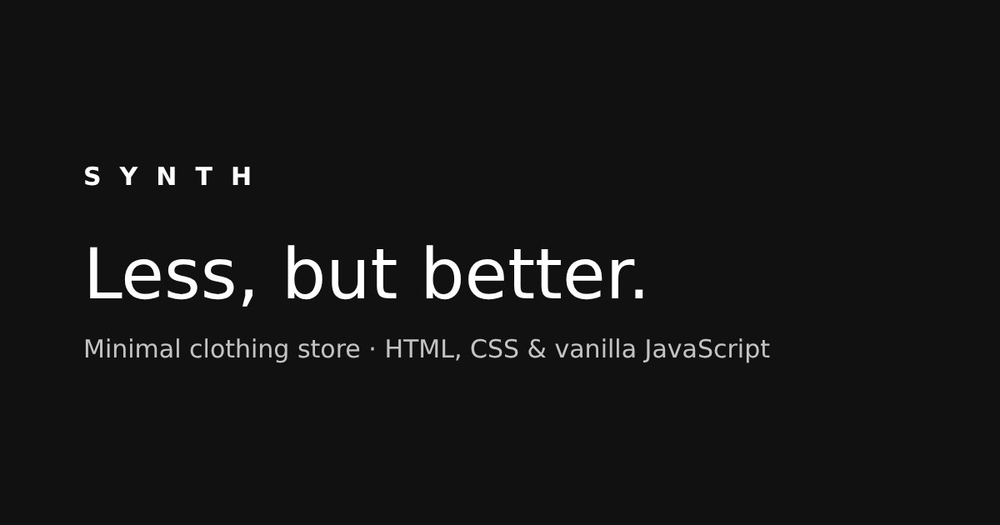

# Synth – Minimal Clothing Store

[](https://github.com/AlexRajdhami/Synth/actions/workflows/deploy.yml)



A responsive online clothing store front-end with a minimal monochrome design, built with **HTML, CSS and vanilla JavaScript**. No frameworks and no build step.

**Live demo:** [alexrajdhami.github.io/Synth](https://alexrajdhami.github.io/Synth/)

> Synth was my first-year university web project. In 2026 I rebuilt it from scratch as a complete, tested and accessible shop demo. This is a portfolio project: no real orders are placed and no payment details are collected.

## Features

- **Product catalogue:** 12 products across 6 categories, defined in one data file (`assets/js/products.js`)
- **Shop page:**
  - category filters, live search and sorting by price, name or newest
  - filters are saved in the URL, so a filtered view can be shared
- **Product pages:**
  - size picker with validation, quantity stepper and related products
  - photo credits on every product
- **Shopping bag:**
  - remembered in `localStorage`, with quantity changes and removals
  - free-delivery progress bar
  - promo code `WELCOME10` for 10% off
- **Checkout:**
  - contact and delivery form with UK postcode, email and phone validation
  - standard or express delivery
  - demo order confirmation
- **Wishlist:** save products with the ♡ button and view them in the shop
- **Contact form and newsletter sign-up**, both with validation
- **Responsive:** a mobile menu, layouts from phone to desktop, and no horizontal scrolling
- **Accessible:**
  - semantic HTML, a skip link and visible focus styles
  - labelled form fields, error messages linked to their fields
  - `aria-live` updates and support for reduced motion
- **Tested:** 16 unit tests for the cart and validation logic, run with Node's built-in test runner
- **CI/CD:** GitHub Actions runs the tests and deploys to GitHub Pages on every push

## Tech stack

| Area | Tools |
|---|---|
| Markup & styling | HTML5, CSS3 (custom properties, Grid, Flexbox) |
| Logic | Vanilla JavaScript (ES modules) |
| Storage | `localStorage` with safe fallbacks |
| Testing | `node:test` (no dependencies) |
| Hosting | GitHub Pages via GitHub Actions |

## Project structure

```
├── index.html        Home: hero, categories, featured products
├── shop.html         Catalogue with filters, search and sorting
├── product.html      Product details (product.html?id=...)
├── cart.html         Shopping bag and promo codes
├── checkout.html     Demo checkout with form validation
├── about.html        Brand story, delivery and size guide
├── contact.html      Contact form
├── assets/
│   ├── css/styles.css
│   └── js/
│       ├── products.js     Product data
│       ├── cart.js         Cart logic (pure, tested)
│       ├── validation.js   Form rules (pure, tested)
│       ├── layout.js       Header, footer, wishlist, toast
│       └── *.js            One small script per page
└── tests/                  Unit tests
```

## Run it locally

ES modules need a local web server (opening the file directly won't work):

```bash
# Node
npx serve .
# or Python
python -m http.server 8000
```

Then open http://localhost:3000 (Node) or http://localhost:8000 (Python).

Run the tests (Node 20+):

```bash
npm test
```

## Adding your own products

Edit `assets/js/products.js`. To use your own image instead of an Unsplash photo, put it in `assets/img/` and add `image: 'assets/img/my-design.jpg'` to the product.

## Credits

Product photos from [Unsplash](https://unsplash.com), used under the [Unsplash License](https://unsplash.com/license). Each product page credits its photographer.

## Author

**Alex Rajdhami**, BSc (Hons) Computer Science, University of East London
[LinkedIn](https://linkedin.com/in/alexrajdhami) · [GitHub](https://github.com/AlexRajdhami)
